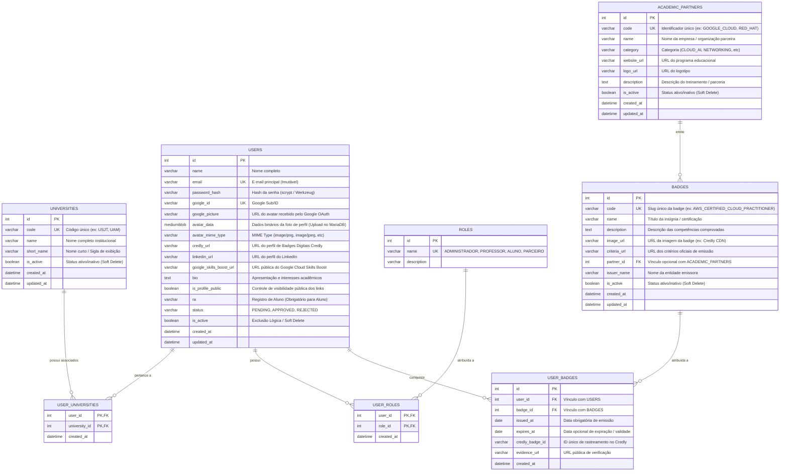

# 🗄️ Modelagem de Dados & Esquema Relacional do Akademus

Este documento especifica o modelo relacional de banco de dados do **Akademus**, implementado no **MariaDB** e mapeado utilizando **SQLAlchemy** (Python).

---

## 📐 Diagrama Entidade-Relacionamento (Mermaid)

---

## 🏛️ Convenções e Regras de Negócio Adotadas

1. **Nomenclatura Relacional:**
   - Tabelas em **plural minúsculo com snake_case**: `universities`, `academic_partners`, `users`, `roles`.
   - Tabelas associativas (Many-to-Many): `user_universities`, `user_roles`.
   - Colunas em **snake_case**: `id`, `short_name`, `password_hash`, `google_id`, `credly_url`, `linkedin_url`, `google_skills_boost_url`, `is_profile_public`, `is_active`.
   - Chaves primárias com auto-incremento `id`.
   - Constraints de unicidade explícitas (`unique=True`) em `universities.code`, `academic_partners.code`, `users.email` e `users.google_id`.
   - Chaves estrangeiras com integridade referencial `ON DELETE CASCADE`.

2. **Exclusão Lógica (Soft Delete):**
   - Implementado através da coluna `is_active BOOLEAN NOT NULL DEFAULT TRUE` em `universities`, `academic_partners` e `users`.
   - Nenhuma exclusão física é executada por padrão, garantindo a integridade dos dados históricos pedagógicos e de auditoria.

3. **Política de Senhas:**
   - Senhas locais exigem no mínimo 8 caracteres, com ao menos 1 maiúscula, 1 minúscula, 1 número e 1 caractere especial, validadas com confirmação de senha.

4. **Regra de Visibilidade e Privacidade (Perfil):**
   - Estudantes escolhem se seus links profissionais (`credly_url`, `linkedin_url`, `google_skills_boost_url`) ficam públicos para outros estudantes (`is_profile_public`).
   - Usuários com papéis `ADMINISTRADOR` ou `PROFESSOR` **sempre têm acesso de visualização**, independentemente da opção do aluno.

5. **Hierarquia de Papéis (Roles):**
   - `ADMINISTRADOR`: Acesso total aos CRUDs de Universidades, Usuários e moderação de novos cadastros.
   - `PROFESSOR`: Não possui RA obrigatório; pode lecionar e estar vinculado a múltiplas universidades.
   - `ALUNO`: RA obrigatório no cadastro; vinculado a uma ou mais universidades.
   - `PARCEIRO`: Instrutores e convidados de empresas parceiras.

6. **Status de Autorização:**
   - Todo usuário que se autocadastra (via formulário ou Google OAuth) inicia com `status = 'PENDING'`.
   - O `ADMINISTRADOR` aprova (`APPROVED`) ou rejeita (`REJECTED`) o acesso na tela de moderação `/users`.
   - Usuário admin mestre pré-configurado: `hpoyatos@gmail.com` (aprovado com papéis `ADMINISTRADOR` e `PROFESSOR` e associado a todas as universidades Ânima).
