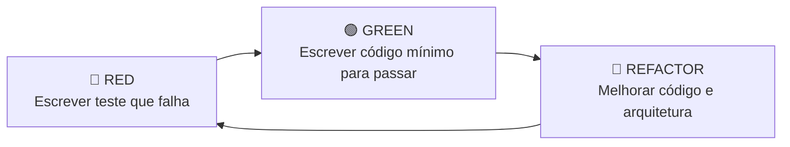

# 🧪 Metodologia TDD (Test-Driven Development) no Akademus

No desenvolvimento do **Akademus**, adotamos o **Test-Driven Development (TDD)** como padrão para garantir a qualidade de software, arquitetura desacoplada e evolução contínua segura sob a abordagem de *Vibe Coding*.

---

## 🔄 O Ciclo Red-Green-Refactor

Cada nova funcionalidade é desenvolvida seguindo estritamente as três etapas:



1. **🔴 RED:** Escrever um teste unitário ou de integração que descreve o comportamento desejado. O teste deve falhar pois a funcionalidade ainda não existe.
2. **🟢 GREEN:** Escrever o código mais simples e limpo possível para fazer o teste passar.
3. **🔵 REFACTOR:** Refatorar e otimizar o código (remover duplicações, melhorar nomes, ajustar design) garantindo que os testes continuem verdes.

---

## 🧰 Stack de Testes (Python / Flask)

- **Test Runner & Framework:** `pytest`
- **Cobertura de Código:** `pytest-cov`
- **Cliente de Testes HTTP:** `pytest-flask` / Flask Test Client nativo
- **Mocking & Isolamento:** `unittest.mock` / `pytest-mock`
- **Banco de Testes:** SQLite em memória (para testes rápidos de unidade) ou container efêmero MariaDB (para testes de integração).

---

## 📂 Estrutura de Testes (`backend/tests`)

```text
backend/tests/
├── conftest.py             # Fixtures globais (app Flask, cliente de teste, banco limpo)
├── unit/                   # Testes unitários puros (regras de negócio, modelos, validações)
│   ├── test_models.py
│   └── test_gamification.py
└── integration/            # Testes de integração de endpoints (API HTTP) e banco de dados
    ├── test_auth_api.py
    └── test_assessments_api.py
```

---

## 🚀 Como Executar os Testes

Dentro do diretório `backend/`:

```bash
# Executar todos os testes
pytest

# Executar com relatório de cobertura de código
pytest --cov=app --cov-report=term-missing

# Executar apenas testes unitários em modo verboso
pytest tests/unit -v
```
